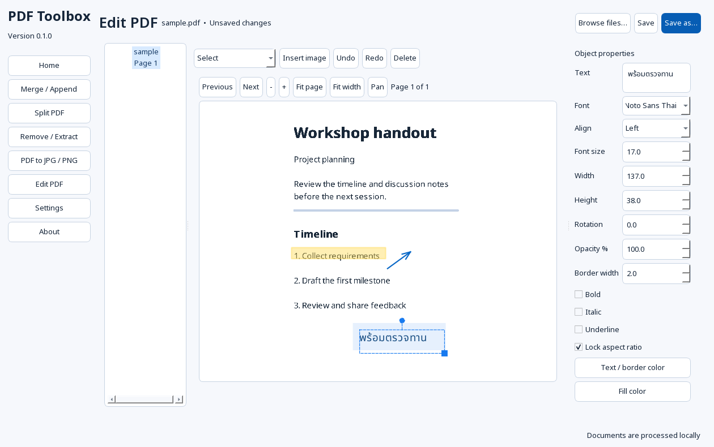

# PDF Toolbox

PDF Toolbox is a local Windows x64 desktop application for combining, splitting, extracting, converting and visually editing PDF pages.



Open [the user guide](USER_GUIDE.md) for installation and usage. See [the feature matrix](FEATURE_MATRIX.md) and [test report](TEST_REPORT.md) for current verification status.

[คู่มือภาษาไทย](USER_GUIDE_TH.md)

## Develop on Windows

Install uv, then run these commands in PowerShell.

```powershell
uv sync --locked
uv run --locked python src/main.py
$env:QT_QPA_PLATFORM = 'offscreen'
uv run --locked pytest
```

The [release guide](RELEASE_GUIDE.md) covers the offline Setup.exe build, private releases and publishing. The [architecture](ARCHITECTURE.md) describes the local processing and editor pipelines.
