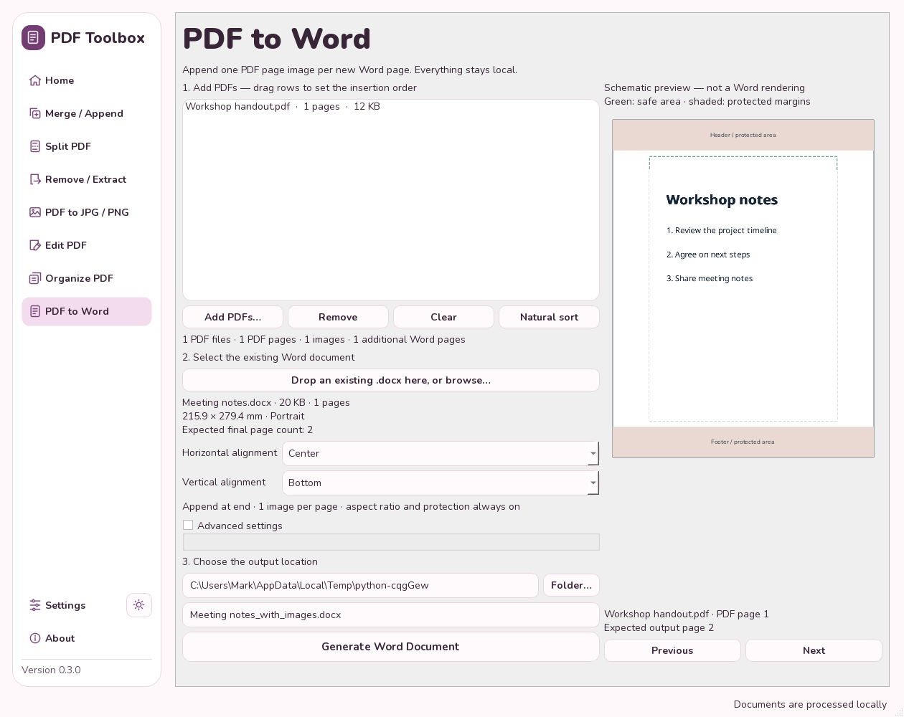

# PDF to Word

This mode appends PDF page images to a separate copy of an existing `.docx` document. PDF rendering and Word automation run locally. Microsoft Word Desktop must be installed and activated. PDF-to-Image and the other PDF tools do not require Word.



## Use

1. Choose **PDF to Word** in the sidebar.
2. Drop PDFs into the file list or click **Add PDFs**. Drag rows to change their order. **Natural sort** orders names such as `2.pdf` before `10.pdf`. Remove selected rows or clear the list as needed.
3. Select an existing `.docx` using its separate drop area or browse button. Close that document in Word first. Inspection uses a disposable copy and Word's pagination engine.
4. Review the PDF page total and expected final Word page count. The preview is explicitly schematic, uses one small rendered PDF image at a time, and does not represent an actual Word-rendered output page.
5. Choose horizontal/vertical alignment. Defaults are center/bottom. Advanced settings expose 150/200/300/600 DPI, JPEG/PNG, JPEG quality, scale and extra safety margin. Defaults are 300 DPI JPEG, quality 95, 100% fit, and 5 mm. Scale above 100% is capped to the available safe area. Aspect ratio and header/footer protection cannot be disabled.
6. Choose an output directory and filename. The default is `{word_name}_with_images.docx`. An existing output prompts for overwrite or a new name. An input file can never be the output.
7. Click **Generate Word Document**. Progress shows the current stage, PDF/page, completed images/pages, elapsed time and an estimate once pages have completed. Cancel requests are handled between operations; an active Word call is allowed to return.
8. Open the generated document or output folder from the success actions.

## Processing and preservation

- Input PDFs retain the order in the list; each PDF retains its page order. There is no fixed file-count limit.
- Existing PDFium/Pillow rendering is reused, including source rotation and JPEG white backgrounds. Pages are rendered sequentially. Only one full-resolution page and its temporary image are retained at a time. Word rendering permits up to 64 million pixels per page; extremely large pages require a lower DPI.
- Each new page uses a Word page break and an embedded picture anchored to a separate nonprinting paragraph. No new section is introduced.
- A private Word instance runs in the worker's COM apartment with macros disabled. Other Word documents are not closed or modified. The instance's link-update preference is restored during cleanup.
- The final package starts from the original `.docx`: original body XML, section settings, headers, footers, styles, numbering, media and other parts are retained. Only the Word-generated appended paragraphs, embedded images, image relationships and necessary content types are added. New relationships/resources use separate IDs and names.
- Before publication the service repaginates, checks image counts, absolute page assignments, placement, original page boundaries, section/header/footer/body preservation, and saved-document reopen. It hashes every input before and after processing. A failure or cancellation discards staging and leaves any existing output intact.
- Output is staged on the destination volume and moved into place only after validation. Processing has no connection to the updater. The existing updater remains opt-in.
- Technical error types and COM/Windows error codes are recorded in rotating local logs under `%LOCALAPPDATA%/PDF Toolbox/logs/word.log`. Document text, images and document paths are not written to this diagnostic log.

## Current limitations and acceptance status

The standard suite and four real Word integration cases passed; see [the test report](PDF_TO_WORD_TEST_REPORT.md). Broader corpus acceptance remains pending, and the following layout limits apply.

- Floating header/footer objects, header/footer tables, framed/bordered headers/footers, final sections with multiple columns, and unmeasurable geometry are rejected explicitly. Plain text headers/footers passed basic real Word tests; inline logos require broader corpus acceptance. Convert floating logos to inline pictures where suitable. Header/footer tables require future occupied-boundary measurement; do not remove needed formatting merely to bypass the check.
- Protected documents, documents with tracked changes enabled, macro-bearing packages, linked external document resources, and inaccessible/locked sources are rejected. Password prompts are suppressed; password-protected files are not supported.
- Page count and original-page-boundary mismatches, including unusual trailing section/break/keep-with-next behavior, stop generation rather than publish a questionable result.
- Dynamic PAGE/NUMPAGES/SECTIONPAGES fields remain fields. Cached page-field values are excluded from semantic comparisons. A read-only reopen verifies layout without saving Word's incidental package rewrites back over preserved parts. Fields may refresh when Word opens/prints the document.
- New panel labels are currently English; existing English/Thai tools remain available.
- Full-resolution 600 DPI images consume more memory. A4 is approximately 35 million pixels; Word itself retains embedded images in its document model. Bounded renderer memory does not imply constant Word memory for arbitrarily large outputs.
- Real Word acceptance covers the synthetic cases in the test report. The panel screenshot is available under `artifacts/screenshots/pdf-to-word.png`. Full-corpus and clean-machine acceptance remain separate from automated checks.

## Development and build

Use the locked Windows Python 3.12 environment:

```powershell
uv sync --locked
uv run --locked ruff check src tests scripts
uv run --locked ruff format --check src tests scripts
uv run --locked mypy --ignore-missing-imports src
uv run --locked pytest
```

Real Word tests are opt-in and use synthetic local fixtures:

```powershell
$env:PDF_TOOLBOX_WORD_TESTS = '1'
uv run --locked pytest tests/test_word_integration.py -p no:faulthandler -v
Remove-Item Env:PDF_TOOLBOX_WORD_TESTS
uv run --locked python scripts/benchmark_word.py --pages 10 25 50 100 200
```

`-p no:faulthandler` avoids Python's Windows first-chance COM exception dumps; it does not suppress test failures. Benchmark JSON is written to `build/word-benchmark.json` and identifies the synthetic workload. CPU includes Python plus the owned Word process; memory is the sum of their process peak working sets, an explicitly labeled upper bound.

After checks pass, use the existing `scripts/build.ps1`. The PyInstaller spec includes `pythoncom`, `pywintypes`, `win32com.client`, `win32com.server` and `win32file`. The only new runtime dependency is pinned `pywin32==311`, which provides real COM automation. Existing `pywin32-ctypes` remains for updater credentials. No PyMuPDF/python-docx dependency is needed.

Verify the executable on disconnected Windows with Word installed, and on a clean machine without Python. Verify PDF-to-Image on a machine without Word. Publishing or pushing requires separate authorization.
